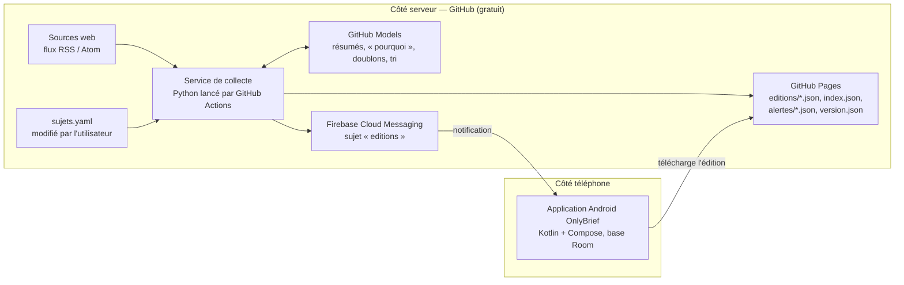

# Cahier des charges — OnlyBrief

**Application Android de veille quotidienne · version finale 1.0 · 13 octobre 2026**
Commanditaire et unique utilisateur : Mathieu Ferrante.

Ce document est la référence de réalisation. Il est rédigé pour être confié tel quel à l'agent de développement (Claude) qui construira le projet. Toutes les décisions sont arrêtées ; il n'y a plus de question ouverte.

---

## 0. Consignes pour l'agent de développement

**Ta mission** : construire OnlyBrief de bout en bout, en suivant les lots de la section 11 dans l'ordre, jusqu'à la recette de la section 12.

**Règles de travail**

1. Travaille lot par lot. À la fin de chaque lot, arrête-toi, présente ce qui a été fait, la façon de le vérifier et les critères de sortie du lot, puis attends la validation de Mathieu avant de passer au suivant.
2. Les identifiants d'exigence (APP-xx, NOT-xx, COL-xx, CFG-xx, ALR-xx, NF-xx) sont le fil conducteur : cite-les dans les messages de commit, les tests et le récapitulatif de fin de lot.
3. Priorités : **Indispensable** = obligatoire pour la version 1 ; **Souhaitable** = à faire au lot 5 si tout l'indispensable passe ; **Optionnel** = ne pas faire en version 1.
4. Budget : **0 €**. N'utilise aucun service payant, aucune clé d'API payante. Si une brique gratuite décrite ici ne fonctionne pas comme prévu, propose une alternative gratuite et attends l'accord avant de changer d'architecture.
5. Ne modifie jamais le format d'édition (section 7) sans le signaler : c'est le contrat entre le service et l'application.
6. Aucun secret dans le dépôt (il est public) : clés Firebase côté serveur, clé de signature de l'APK et jetons vont dans les secrets GitHub ou restent chez Mathieu.
7. Langue : interface, résumés, messages de journal destinés à l'utilisateur et documentation en français. Noms de variables et de fonctions au choix, mais cohérents.
8. Tests : le service Python a des tests automatiques (pytest) pour le filtrage, la déduplication, le calcul des horaires (heure d'été / d'hiver) et la validation de `sujets.yaml`. L'application a au minimum des tests sur la lecture et le stockage des éditions.

**Dépôt** : le dépôt public `onlybrief` est déjà créé sur GitHub. Copie locale sur le PC Windows : `C:\Users\mathieu.ferrante\Documents\Projetperso\Veille\OnlyBrief`. Ce cahier des charges y est rangé sous le nom `CAHIER_DES_CHARGES.md`.

**Ce que Mathieu fait lui-même** (l'agent prépare les instructions pas à pas, en français) :

- activer GitHub Pages (dossier `docs/` de la branche principale) et autoriser GitHub Actions à écrire dans le dépôt ;
- créer le projet Firebase (gratuit), récupérer le fichier `google-services.json` et la clé de compte de service, puis les déposer aux endroits indiqués ;
- générer et sauvegarder la clé de signature de l'APK (deux copies hors du poste) ;
- installer l'APK sur son POCO M7 Pro 5G et faire les tests sur le téléphone réel ;
- relire les éditions du lot 1 et valider chaque lot.

Postes disponibles pour le développement : PC Windows (Ryzen 7 5700X) et MacBook Air M2.

---

## 1. Objet et contexte

OnlyBrief livre chaque matin sur le téléphone une édition de veille courte, organisée par sujet, et prévient son lecteur par une notification. Une alerte peut aussi signaler une annonce majeure en cours de journée.

Décisions arrêtées :

| Point | Décision |
| --- | --- |
| Forme | Vraie application Android, fichier .apk installé hors Play Store (autorisation « sources inconnues » acceptée) |
| Appareil | Téléphone personnel POCO M7 Pro 5G, HyperOS, livré sous Android 14, mis à jour en Android 15 |
| Rythme | Une édition par jour : 7h30 du lundi au vendredi, 10h le samedi et le dimanche, heure de Paris |
| Alerte | Une alerte au plus par jour, en cours de journée, pour une annonce majeure |
| Sujets de départ | IA / LLM (tout), tech générale (tout), Counter-Strike et esport (tout ; scène française et mondiale, rien sous le tier 2) — d'autres sujets s'ajoutent dans `sujets.yaml` |
| Contenu d'un item | Titre, résumé de deux lignes en français, ligne « Pourquoi c'est important », source, heure |
| Sources | Françaises et anglaises, fiables (section 13) ; 5 items maximum par sujet |
| Historique | 30 éditions conservées sur le téléphone |
| Hébergement | Compte GitHub existant, dépôt public `onlybrief` |
| Budget | 0 € par mois |
| Version 1 | Pas de date imposée : la première version installée doit être aussi proche que possible de la version finale |

Le système a deux parties : un **service** qui collecte et rédige l'édition, et l'**application** qui la reçoit et l'affiche. L'application ne contient aucune règle de veille : changer de sujets, de sources ou de règles se fait côté service, sans réinstaller l'application.

---

## 2. Architecture



- Le service s'exécute dans GitHub Actions : collecte, filtre, résume via GitHub Models, publie les fichiers JSON dans le dossier servi par GitHub Pages (commit dans le dépôt), puis envoie la notification par FCM.
- L'application s'abonne au sujet FCM `editions` (pas de gestion de jetons côté serveur), télécharge l'édition depuis GitHub Pages et la stocke en local pour la lecture hors ligne.

---

## 3. Parcours utilisateur

Une journée type, un mardi :

1. Pendant la nuit, le service collecte les articles publiés depuis l'édition précédente, écarte le bruit et les doublons, résume les items retenus.
2. À 7h30, l'édition est publiée et le téléphone affiche : « Veille du mardi 13 octobre — 12 actualités ».
3. Un appui sur la notification ouvre l'application directement sur l'édition du jour.
4. L'utilisateur parcourt les trois sections, déroule celles qui l'intéressent et ouvre un article dans le navigateur s'il veut le lire en entier.
5. L'édition reste consultable hors connexion, dans le métro ou en zone blanche.
6. Vers 15h, une alerte signale une annonce majeure ; elle réapparaît le lendemain dans l'édition, marquée « déjà signalée ».
7. Plus tard dans la semaine, il retrouve une information dans l'historique.
8. Pour suivre un nouveau sujet, il modifie `sujets.yaml` : l'édition suivante contient la nouvelle section, sans mise à jour de l'application.

---

## 4. Exigences — application

Quatre écrans : édition du jour, détail d'un item, historique, réglages.

| ID | Exigence | Priorité |
| --- | --- | --- |
| APP-01 | À l'ouverture, l'application affiche la dernière édition disponible, avec sa date et le nombre d'items. | Indispensable |
| APP-02 | L'édition est découpée en une section par sujet, dans l'ordre défini par la configuration ; chaque section se replie et se déplie. | Indispensable |
| APP-03 | Chaque item affiche son titre, un résumé de deux lignes, une ligne « Pourquoi c'est important », le nom de la source et l'heure de publication. | Indispensable |
| APP-04 | Un appui sur un item ouvre l'article d'origine dans le navigateur du téléphone. | Indispensable |
| APP-05 | Une section sans actualité l'indique (« Rien de notable aujourd'hui ») plutôt que de disparaître. | Indispensable |
| APP-06 | Une source injoignable lors de la collecte est signalée en pied de section. | Souhaitable |
| APP-07 | L'écran Historique liste les éditions passées, la plus récente en haut, et ouvre n'importe laquelle. | Indispensable |
| APP-08 | Les éditions déjà téléchargées se lisent sans connexion. | Indispensable |
| APP-09 | Un geste « tirer pour actualiser » force la vérification d'une nouvelle édition. | Indispensable |
| APP-10 | Les items ouverts sont marqués comme lus et visuellement atténués. | Optionnel |
| APP-11 | Un item peut être partagé via le menu de partage d'Android. | Optionnel |
| APP-12 | Un item peut être mis de côté dans une liste « À relire ». | Optionnel |
| APP-13 | Les réglages permettent de couper les notifications et de masquer un sujet sur le téléphone. | Optionnel |
| APP-14 | L'application suit le thème clair ou sombre du téléphone. | Optionnel |
| APP-15 | L'écran Réglages affiche la version de l'application et signale qu'une version plus récente est disponible (lecture de `version.json`). | Souhaitable |
| APP-16 | Une alerte reçue s'affiche dans un bandeau en haut de l'édition du jour jusqu'à la prochaine édition. | Indispensable |

---

## 5. Exigences — notifications

| ID | Exigence | Priorité |
| --- | --- | --- |
| NOT-01 | Une notification est émise à la publication de chaque édition : 7h30 du lundi au vendredi, 10h le samedi et le dimanche, heure de Paris. | Indispensable |
| NOT-02 | La notification porte la date de l'édition et le nombre d'actualités, par exemple « Veille du mardi 13 octobre — 12 actualités ». | Indispensable |
| NOT-03 | Un appui sur la notification ouvre l'application sur l'édition (ou l'alerte) annoncée. | Indispensable |
| NOT-04 | L'édition est téléchargée à la réception de la notification ; à défaut, à l'ouverture de l'application. | Souhaitable |
| NOT-05 | Une seule notification par édition, même en cas de nouvel essai d'envoi côté service. | Indispensable |
| NOT-06 | Au premier lancement, l'application demande l'autorisation d'afficher des notifications (obligatoire depuis Android 13). | Indispensable |
| NOT-07 | Si l'édition n'a pas pu être produite, aucune notification « vide » n'est envoyée ; l'échec est consigné côté service. | Indispensable |
| NOT-08 | Une alerte signale une annonce majeure en cours de journée, distincte de l'édition (règles ALR-01 et ALR-02), sur un canal de notification Android séparé. | Indispensable |

---

## 6. Exigences — service, configuration et alertes

| ID | Exigence | Priorité |
| --- | --- | --- |
| COL-01 | Le service s'exécute chaque jour sans intervention, de façon à publier l'édition à l'heure fixée (NOT-01). | Indispensable |
| COL-02 | Il lit les sources déclarées pour chaque sujet par leurs flux RSS ou Atom. | Indispensable |
| COL-03 | Il ne retient que les articles publiés depuis l'édition précédente. | Indispensable |
| COL-04 | Il écarte les articles contenant un mot-clé d'exclusion du sujet ; pour une source marquée `mots_cles_obligatoires`, il ne garde que les articles contenant un mot-clé du sujet. | Indispensable |
| COL-05 | Il fusionne les articles qui traitent du même fait sous un seul item, en gardant la source la plus fiable et en citant les autres. | Souhaitable |
| COL-06 | Il ne reprend pas un lien déjà cité dans les 14 derniers jours (état conservé dans le dépôt). | Indispensable |
| COL-07 | Il plafonne chaque section à `max_items`, en gardant les plus importants. | Indispensable |
| COL-08 | Il rédige pour chaque item un résumé de deux lignes en français et une ligne « Pourquoi c'est important », sans reprendre le texte de l'article ni ajouter d'information absente de l'article. | Indispensable |
| COL-09 | Il publie l'édition dans un fichier daté (section 7) et met à jour `index.json` ; il supprime du site les éditions de plus de 60 jours. | Indispensable |
| COL-10 | Une source injoignable ne bloque pas l'édition : elle est signalée dans le fichier publié et l'édition part avec les autres. | Indispensable |
| COL-11 | Il déclenche l'envoi de la notification une fois l'édition publiée et en ligne. | Indispensable |
| COL-12 | Il consigne chaque exécution : heure, sources lues, items retenus et écartés, requêtes au modèle, erreurs (journal GitHub Actions + résumé dans le fichier d'édition). | Indispensable |
| COL-13 | Si l'appel au modèle échoue ou que le quota est atteint, l'item part avec le chapô du flux RSS, et l'édition le signale. | Indispensable |
| CFG-01 | Les sujets sont décrits dans un unique fichier `sujets.yaml`, lisible et modifiable sans compétence en programmation. | Indispensable |
| CFG-02 | Ajouter, retirer ou modifier un sujet se fait dans ce seul fichier et prend effet à l'édition suivante, sans toucher à l'application. | Indispensable |
| CFG-03 | Un fichier mal formé est détecté avant l'exécution ; le service garde la dernière configuration valide et signale l'erreur. | Indispensable |
| CFG-04 | Un sujet peut être suspendu sans être supprimé (`actif: false`). | Souhaitable |
| CFG-05 | Chaque sujet peut porter des `consignes` en langage courant transmises au modèle (exemple : « pas en dessous du tier 2 ») et une liste `mots_cles_alerte`. | Indispensable |
| ALR-01 | Toutes les 2 heures de 9h à 21h (heure de Paris), le service relit les sources et repère un fait majeur : repris par au moins 3 sources en moins de 2 heures, ou contenant un mot-clé d'alerte du sujet, puis confirmé par le modèle de langage. | Indispensable |
| ALR-02 | Une alerte au plus par jour ; l'information alertée est reprise dans l'édition suivante et marquée « déjà signalée ». | Indispensable |

---

## 7. Formats de données

Ces fichiers sont le contrat entre le service et l'application. Ils sont publiés par GitHub Pages à l'adresse `https://<compte>.github.io/onlybrief/`.

### 7.1 Configuration des sujets — `sujets.yaml` (racine du dépôt)

```yaml
modele:
  fournisseur: github-models     # réglage du service, modifiable sans toucher à l'application
  nom: "<modèle de niveau « low » disponible dans GitHub Models>"

sujets:
  - id: ia
    nom: "IA / LLM"
    actif: true
    ordre: 1
    max_items: 5
    langues: [fr, en]
    mots_cles: ["LLM", "modèle de langage", "IA générative", "AI Act", "agent IA"]
    exclusions: ["horoscope", "crypto"]
    mots_cles_alerte: ["nouveau modèle", "GPT", "Claude", "Gemini"]
    sources:
      - nom: "OpenAI News"
        flux: "https://openai.com/news/rss.xml"
      - nom: "Hugging Face Blog"
        flux: "https://huggingface.co/blog/feed.xml"
      - nom: "Simon Willison"
        flux: "https://simonwillison.net/atom/everything/"
      - nom: "ActuIA"
        flux: "https://www.actuia.com/feed/"

  - id: tech
    nom: "Tech générale"
    actif: true
    ordre: 2
    max_items: 5
    langues: [fr, en]
    mots_cles: []        # vide : tout le flux est candidat
    exclusions: ["bon plan", "promo"]
    sources:
      - nom: "Next"
        flux: "https://next.ink/feed/"

  - id: cs2
    nom: "Counter-Strike / esport"
    actif: true
    ordre: 3
    max_items: 5
    langues: [fr, en]
    mots_cles: ["CS2", "Counter-Strike", "Major", "patch", "transfert"]
    exclusions: ["skin", "case opening"]
    consignes: "Scène française et mondiale ; ignorer les compétitions en dessous du tier 2."
    sources:
      - nom: "HLTV.org"
        flux: "https://www.hltv.org/rss/news"
      - nom: "CS2 — actualités officielles (Steam)"
        flux: "https://store.steampowered.com/feeds/news/app/730/"
      - nom: "Dexerto.fr"
        flux: "https://www.dexerto.fr/feed/"
        mots_cles_obligatoires: true
```

Les sources « à vérifier » de la section 13 sont ajoutées au lot 1 si leur flux répond.

### 7.2 Édition — `editions/AAAA-MM-JJ.json`

```json
{
  "date": "2026-10-13",
  "publiee_le": "2026-10-13T07:30:00+02:00",
  "nb_items": 12,
  "resumes_degrades": false,
  "sections": [
    {
      "sujet_id": "ia",
      "nom": "IA / LLM",
      "sources_en_echec": [],
      "items": [
        {
          "id": "ia-2026-10-13-01",
          "titre": "Titre de l'article",
          "resume": "Deux lignes rédigées par le service, en français.",
          "pourquoi": "Une ligne sur la portée de l'information.",
          "deja_signale": false,
          "source": "OpenAI News",
          "lien": "https://openai.com/...",
          "publie_le": "2026-10-12T18:04:00+02:00",
          "autres_sources": []
        }
      ]
    }
  ]
}
```

### 7.3 Index — `index.json`

```json
{
  "mis_a_jour_le": "2026-10-13T07:30:00+02:00",
  "editions": [
    { "date": "2026-10-13", "nb_items": 12, "fichier": "editions/2026-10-13.json" }
  ],
  "derniere_alerte": { "date": "2026-10-13", "fichier": "alertes/2026-10-13.json" }
}
```

### 7.4 Alerte — `alertes/AAAA-MM-JJ.json`

```json
{
  "date": "2026-10-13",
  "emise_le": "2026-10-13T15:02:00+02:00",
  "sujet_id": "ia",
  "item": { "id": "alerte-2026-10-13", "titre": "…", "resume": "…", "pourquoi": "…",
            "source": "…", "lien": "…", "publie_le": "…", "autres_sources": ["…", "…"] }
}
```

### 7.5 Version de l'application — `version.json`

```json
{ "version": "1.0.0", "code": 1, "apk": "https://github.com/<compte>/onlybrief/releases/download/v1.0.0/onlybrief-1.0.0.apk" }
```

### 7.6 Messages FCM

Envoyés au sujet `editions`, priorité haute, avec un bloc `notification` (titre et texte affichables même si l'application est arrêtée) et un bloc `data` :

- édition : `{"type": "edition", "date": "2026-10-13", "nb_items": "12"}` ;
- alerte : `{"type": "alerte", "date": "2026-10-13"}`.

Un identifiant de message dérivé de la date (et du type) permet à l'application d'ignorer un doublon (NOT-05).

L'application ne dépend que de ces formats. Tant qu'ils ne changent pas, le service peut évoluer sans nouvelle version de l'application.

---

## 8. Exigences non fonctionnelles

| ID | Thème | Exigence |
| --- | --- | --- |
| NF-01 | Compatibilité | Android 8.0 (API 26) et plus ; cible : POCO M7 Pro 5G sous HyperOS, Android 14 / 15. |
| NF-02 | Rapidité | L'édition du jour s'affiche en moins de 2 secondes après l'ouverture si elle est déjà téléchargée. |
| NF-03 | Hors ligne | Toutes les éditions conservées se lisent sans réseau ; seuls les liens vers les articles en demandent un. |
| NF-04 | Batterie | Aucun traitement en arrière-plan hors réception d'une notification et téléchargement de l'édition. |
| NF-05 | Poids | APK de moins de 15 Mo ; une édition de moins de 100 Ko. |
| NF-06 | Stockage | L'application conserve les 30 dernières éditions et supprime les plus anciennes. |
| NF-07 | Fiabilité | 19 éditions sur 20 publiées et notifiées à l'heure, sans intervention. |
| NF-08 | Sécurité | HTTPS uniquement ; aucun secret dans le dépôt ni dans l'application (hors `google-services.json`, prévu pour être embarqué). |
| NF-09 | Vie privée | Aucun compte, aucune mesure d'audience, aucune donnée envoyée depuis le téléphone hors l'abonnement FCM. |
| NF-10 | Lisibilité | Respect de la taille de police du téléphone ; contrastes suffisants. |
| NF-11 | Reprise | Code versionné et documenté ; une note d'une page permet à un tiers de recompiler et resigner l'application. |
| NF-12 | Langue | Interface et résumés en français, quelle que soit la langue de la source. |

---

## 9. Choix techniques et mise en œuvre

| Composant | Choix retenu | Remarque |
| --- | --- | --- |
| Application | Kotlin + Jetpack Compose, minSdk 26 | Projet Gradle dans `app/` |
| Stockage local | Room (SQLite) | Éditions, items, alertes ; purge au-delà de 30 éditions |
| Réseau | Retrofit ou Ktor + kotlinx.serialization | Lecture des JSON de GitHub Pages |
| Notifications | Firebase Cloud Messaging, abonnement au sujet `editions` | Deux canaux Android : « Éditions » et « Alertes » |
| Service | Python 3.12 (feedparser, httpx, PyYAML) lancé par GitHub Actions | Code dans `service/`, tests pytest |
| Résumés, tri, doublons, alertes | GitHub Models, appelé depuis GitHub Actions avec le `GITHUB_TOKEN` (permission `models: read`) | Gratuit ; un appel par sujet avec ses candidats, sous 8 000 jetons d'entrée |
| Envoi FCM | API FCM HTTP v1 (par exemple `firebase-admin`) | Clé de compte de service dans le secret `FIREBASE_SERVICE_ACCOUNT` |
| Publication | Fichiers JSON dans `docs/`, servis par GitHub Pages | Chaque exécution commite ses fichiers (garde aussi les tâches planifiées actives) |
| Distribution | GitHub Releases + `version.json` | APK signé construit par une action sur tag `v*`, clé de signature en secret (`KEYSTORE_BASE64`, mots de passe) |

**Structure du dépôt**

```
onlybrief/
├── CAHIER_DES_CHARGES.md      # ce document
├── README.md                  # présentation + note d'exploitation (1 page)
├── sujets.yaml
├── service/
│   ├── pyproject.toml
│   ├── src/onlybrief/         # config, collecte, filtres, resume, publication, notification, alertes, horaires
│   └── tests/
├── etat/liens_cites.json      # liens des 14 derniers jours (COL-06), dernière config valide (CFG-03)
├── docs/                      # publié par GitHub Pages
│   ├── index.json  version.json  apercu.html
│   ├── editions/
│   └── alertes/
├── app/                       # application Android
└── .github/workflows/
    ├── edition.yml            # édition quotidienne
    ├── alertes.yml            # vérification toutes les 2 heures
    └── apk.yml                # construction et publication de l'APK signé
```

**Horaires** — GitHub Actions planifie en UTC et peut partir en retard. Le workflow `edition.yml` déclare les deux horaires possibles (heure d'été et heure d'hiver), démarrés 45 minutes avant la publication ; le script calcule l'heure de Paris (`zoneinfo`), sort sans rien faire si ce n'est pas le bon créneau, sinon prépare l'édition, la publie, attend l'heure exacte et envoie la notification.

| Publication (Paris) | Été (UTC+2) | Hiver (UTC+1) | Cron de démarrage |
| --- | --- | --- | --- |
| 7h30, lundi–vendredi | 5h30 UTC | 6h30 UTC | `45 4 * * 1-5` et `45 5 * * 1-5` |
| 10h, samedi–dimanche | 8h00 UTC | 9h00 UTC | `15 7 * * 0,6` et `15 8 * * 0,6` |

`alertes.yml` démarre toutes les heures et ne travaille qu'à 9h, 11h, 13h, 15h, 17h, 19h et 21h, heure de Paris (le script sort sans rien faire aux autres heures). Les deux workflows partagent un groupe `concurrency` pour ne pas se chevaucher. Le `workflow_dispatch` est activé sur chacun pour les tests manuels.

**Points d'attention**

- HyperOS limite fortement les applications en arrière-plan : la notification doit être affichable par le système à partir du seul bloc `notification` ; le téléchargement est relancé à l'ouverture. La note d'exploitation décrit les réglages « Démarrage automatique » et « Aucune restriction » de la batterie.
- La clé de signature est créée une fois, sauvegardée en deux copies hors du poste et jamais déposée dans le dépôt.
- Le nom exact du modèle GitHub Models est choisi au lot 1 parmi les modèles gratuits de niveau « low », et inscrit dans `sujets.yaml`.

---

## 10. Hors périmètre

- Play Store ou tout autre magasin d'applications.
- Version iOS, web ou poste de travail.
- Appareil professionnel du CD83.
- Comptes, plusieurs lecteurs, synchronisation entre appareils.
- Modification de la configuration depuis l'application.
- Recherche plein texte dans l'historique.
- Lecture des articles dans l'application.
- Sources payantes, sous abonnement ou nécessitant un compte, dont les réseaux sociaux authentifiés.
- Vidéos, podcasts et directs (YouTube, Twitch).
- Alertes autres que celles de NOT-08 / ALR-01 / ALR-02.
- Mesure d'audience et statistiques d'usage.
- Toute exigence marquée Optionnel.

---

## 11. Livrables et lots

**Livrables**

- L'APK signé, installé et testé sur le POCO M7 Pro 5G.
- Le service de collecte, ses workflows et `sujets.yaml` renseigné pour les trois sujets.
- Le code source des deux parties dans le dépôt public `onlybrief`.
- Une note d'exploitation d'une page (dans le README) : ajouter un sujet, lire le journal d'exécution, réglages batterie HyperOS, recompiler et installer une nouvelle version.
- La clé de signature, conservée par Mathieu avec sa sauvegarde.

**Lots** — chacun validé par Mathieu avant le suivant.

| Lot | Contenu | Critères de sortie |
| --- | --- | --- |
| 1. Contenu | Service Python : lecture de `sujets.yaml`, collecte, filtres, déduplication, appel à GitHub Models, écriture d'une édition JSON conforme à la section 7 ; page `docs/apercu.html` qui affiche l'édition. Vérification des sources « à vérifier ». | Trois éditions successives relues par Mathieu et jugées pertinentes ; tests pytest au vert |
| 2. Publication | Workflow `edition.yml`, horaires été / hiver, publication sur GitHub Pages, mise à jour de l'index, état des 14 jours, journal. | Éditions publiées seules à l'heure pendant 3 jours, dont la nuit du 24 au 25 octobre 2026 si le lot est prêt |
| 3. Application | Application Compose : édition du jour, sections, items, ouverture des articles, historique, hors ligne, tirer pour actualiser, Room, purge à 30 éditions. | Toutes les exigences APP Indispensables vérifiées sur le téléphone |
| 4. Notifications et alertes | Projet Firebase, abonnement au sujet, envoi après publication, ouverture sur l'édition, dédoublonnage ; workflow `alertes.yml`, ALR-01, ALR-02, APP-16. | Notification à l'heure, téléphone verrouillé une nuit ; une alerte de test reçue une seule fois |
| 5. Finitions | Exigences Souhaitables (APP-06, APP-15, NOT-04, COL-05, CFG-04), workflow `apk.yml`, icône et nom, note d'exploitation. | APK v1.0.0 publiée et installée ; recette lancée |

**Identité** : nom affiché « OnlyBrief » ; icône simple représentant un journal plié, couleur principale bleue.

---

## 12. Recette

L'application est acceptée quand chacun de ces tests passe sur le POCO M7 Pro 5G.

- [ ] Installation de l'APK depuis le fichier, sans autre manipulation que l'autorisation « sources inconnues ».
- [ ] Notification reçue à 7h30 un jour de semaine et à 10h un jour de week-end, téléphone verrouillé depuis la veille.
- [ ] Notification reçue à l'heure après une nuit téléphone verrouillé et en charge, avec les réglages de batterie d'usine puis avec les réglages recommandés.
- [ ] Appui sur la notification : ouverture directe sur l'édition annoncée.
- [ ] Mode avion activé après réception : l'édition du jour et les précédentes restent lisibles.
- [ ] Chaque item porte sa ligne « Pourquoi c'est important » ; aucun item Counter-Strike ne concerne une compétition sous le tier 2.
- [ ] Une source volontairement cassée dans `sujets.yaml` : l'édition part quand même et signale la source.
- [ ] Un quatrième sujet ajouté par Mathieu seul dans `sujets.yaml` : présent dans l'édition suivante, sans réinstaller l'application.
- [ ] Un `sujets.yaml` mal formé : la dernière configuration valide est conservée et l'erreur est consignée.
- [ ] Aucun lien répété d'une édition à l'autre sur une semaine.
- [ ] Modèle de langage indisponible (simulé) : l'édition part avec les chapôs RSS et le signale.
- [ ] Une alerte de test en cours de journée arrive une seule fois ; l'information figure ensuite dans l'édition suivante, marquée « déjà signalée ».
- [ ] Installation d'une nouvelle version par-dessus l'ancienne : historique conservé.
- [ ] Passage à l'heure d'hiver (nuit du 24 au 25 octobre 2026) : publication toujours à l'heure de Paris (sinon, test reporté au passage à l'heure d'été de mars 2027 et simulé par les tests automatiques).
- [ ] Sur vingt éditions consécutives, au moins dix-neuf publiées et notifiées à l'heure.

---

## 13. Sources de départ

Huit flux ont été ouverts et lus le 13 octobre 2026 (« Vérifié ») ; les autres sont à vérifier au lot 1 et ajoutés seulement s'ils répondent. Un site sans flux ou trop bavard est remplacé plutôt que contourné.

| Sujet | Source | Langue | Flux | État |
| --- | --- | --- | --- | --- |
| IA / LLM | OpenAI News | en | https://openai.com/news/rss.xml | Vérifié |
| IA / LLM | Hugging Face Blog | en | https://huggingface.co/blog/feed.xml | Vérifié |
| IA / LLM | Simon Willison | en | https://simonwillison.net/atom/everything/ | Vérifié |
| IA / LLM | ActuIA | fr | https://www.actuia.com/feed/ | Vérifié |
| IA / LLM | The Decoder | en | https://the-decoder.com/feed/ | À vérifier |
| Tech générale | Next | fr | https://next.ink/feed/ | Vérifié |
| Tech générale | Numerama | fr | https://www.numerama.com/feed/ | À vérifier |
| Tech générale | Frandroid | fr | https://www.frandroid.com/feed | À vérifier |
| Tech générale | CERT-FR (alertes de sécurité) | fr | voir https://cert.ssi.gouv.fr/flux-rss/ | À vérifier |
| Tech générale | Ars Technica | en | https://feeds.arstechnica.com/arstechnica/index | À vérifier |
| Counter-Strike | HLTV.org | en | https://www.hltv.org/rss/news | Vérifié |
| Counter-Strike | CS2 — actualités officielles (Steam) | en | https://store.steampowered.com/feeds/news/app/730/ | Vérifié |
| Counter-Strike | Dexerto.fr | fr | https://www.dexerto.fr/feed/ | Vérifié (filtré par mots-clés) |
| Counter-Strike | Dust2.fr | fr | https://www.dust2.fr/rss | À vérifier |

Le flux Steam couvre les patchs ; HLTV les tournois et transferts ; Dust2.fr et Dexerto.fr la scène française.

---

## 14. Coûts et limites gratuites

Budget : **0 € par mois**. Offres gratuites au 13 octobre 2026 :

| Poste | Choix | Limite à surveiller |
| --- | --- | --- |
| Résumés et alertes | GitHub Models | 150 requêtes par jour et 8 000 jetons d'entrée par requête (modèles « low ») |
| Exécution | GitHub Actions, dépôt public | Tâches planifiées désactivées après 60 jours sans activité dans le dépôt |
| Publication | GitHub Pages | Dépôt public obligatoire avec l'offre gratuite |
| Notifications | Firebase Cloud Messaging | Compte Google |
| Distribution | GitHub Releases | — |

Besoin estimé : 3 requêtes pour l'édition (une par sujet, une trentaine d'articles par lot) et jusqu'à 21 pour les alertes (3 par passage, 7 passages), soit 24 requêtes par jour sur 150.

Références : [GitHub Models — offre gratuite](https://docs.github.com/en/github-models/use-github-models/prototyping-with-ai-models) · [GitHub Models dans GitHub Actions](https://microsoft.github.io/genaiscript/blog/github-models-in-github-actions/) · [GitHub Pages](https://docs.github.com/en/pages/getting-started-with-github-pages/what-is-github-pages) · [Désactivation des tâches planifiées](https://docs.github.com/en/actions/how-tos/manage-workflow-runs/disable-and-enable-workflows)

---

## 15. Risques et parades

| Risque | Effet | Probabilité | Parade |
| --- | --- | --- | --- |
| Retard des tâches planifiées GitHub Actions | Édition après l'heure | Moyenne | Démarrage 45 min avant ; notification envoyée à l'heure exacte par le script |
| Désactivation des tâches planifiées après 60 jours sans activité | Plus aucune édition | Faible | Chaque exécution commite ses fichiers dans le dépôt |
| Économie de batterie HyperOS | Notification retardée, téléchargement interrompu | Élevée | FCM priorité haute avec bloc `notification` ; téléchargement relancé à l'ouverture ; réglages documentés |
| Flux RSS supprimé ou modifié | Section appauvrie | Moyenne | COL-10, APP-06 ; source en échec 3 jours de suite signalée dans le journal |
| Flux trop bavard (Dexerto.fr) | Bruit | Moyenne | `mots_cles_obligatoires` + exclusions |
| Résumé inexact | Information fausse | Faible | Titre d'origine affiché, lien vers l'article, consigne de ne rien ajouter |
| Quota GitHub Models réduit ou supprimé | Résumés absents ou en anglais | Faible | Repli sur le chapô RSS (COL-13) ; fournisseur du modèle réglable dans `sujets.yaml` |
| Alerte pour un fait mineur | Notification inutile | Moyenne | Une alerte par jour au plus, seuil de 3 sources, alertes consignées pour ajuster les mots-clés |
| Perte de la clé de signature | Mise à jour impossible sans désinstaller | Faible | Deux copies hors du poste dès la création |

---

## 16. Planning indicatif

Démarrage le 14 octobre 2026, en jours ouvrés ; chaque date dépend de la validation du lot précédent.

| Étape | Dates |
| --- | --- |
| Lot 1 · Contenu | 14 – 21 octobre |
| Lot 2 · Publication | 22 – 24 octobre (prêt avant le passage à l'heure d'hiver du 25 octobre) |
| Lot 3 · Application | 26 octobre – 6 novembre |
| Lot 4 · Notifications et alertes | 9 – 18 novembre |
| Lot 5 · Finitions | 19 – 25 novembre |
| **Version 1 complète installée** | **25 novembre** |
| Recette (20 éditions consécutives) | 26 novembre – 15 décembre |

---

## Annexe — Réponses de cadrage (13 octobre 2026)

| Q | Réponse retenue |
| --- | --- |
| Q1 Téléphone | POCO M7 Pro 5G |
| Q2 Sources inconnues | Oui |
| Q3 Notifications | Firebase Cloud Messaging |
| Q4 Alerte en journée | Oui |
| Q5 Items par sujet | 5 (proposition par défaut) |
| Q6 Langues | Français et anglais, sources fiables |
| Q7 Sources | Liste de la section 13 (proposition par défaut) |
| Q8 IA | Tout |
| Q9 Tech | Tout |
| Q10 Counter-Strike | Tout ; scène française et mondiale, rien sous le tier 2 |
| Q11 « Pourquoi c'est important » | Oui, toujours |
| Q12 GitHub | Compte existant, dépôt public `onlybrief` |
| Q13 Budget | 0 € |
| Q14 Historique | 30 éditions |
| Q15 Souhaitables en V1 | Aucune parmi APP-10, 11, 13, 14 |
| Q16 Nom | OnlyBrief (choix laissé à Claude) |
| Q17 Délai | Pas de date ; V1 aussi proche que possible de la version finale |
